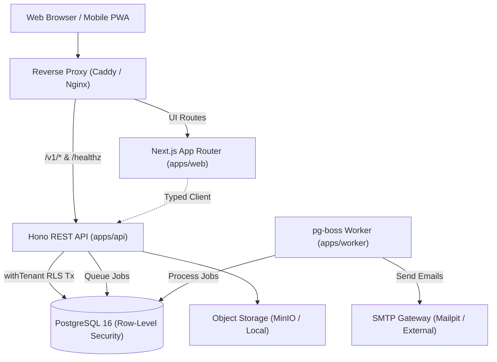

# OpenHR

Open-source (AGPL-3.0-or-later), self-hostable, multi-tenant Human Resources Information System (HRIS) designed for European SMBs, starting with Spain and Catalonia.

[](https://github.com/openhr-project/openhr/actions)
[](https://www.gnu.org/licenses/agpl-3.0)

> **Clean-Room Guarantee:** OpenHR is designed and built strictly from first principles, public statutory law, and generic domain expertise. It is not affiliated with, nor copied from, any commercial HR vendor. See [`CLEANROOM.md`](CLEANROOM.md).

---

## Architecture Overview



### Monorepo Structure

```
apps/
  web/          Next.js App Router frontend with i18n and dark mode
  api/          Hono REST API with OpenAPI contracts and Better Auth
  worker/       pg-boss background jobs processor with idempotency
packages/
  core/         Pure TypeScript domain logic (working-days, balances, hash chain)
  db/           Drizzle schema, PostgreSQL RLS policies, migrations, seeds
  contracts/    Shared Zod schemas, OpenAPI specs, typed API client
  ui/           Design system (shadcn/Radix-based), CSS tokens, Storybook
  i18n/         Catalogs (ca, es, en) and CI validation tools
  emails/       React Email templates (Invite, Password Reset)
  config/       Shared ESLint flat configs, Prettier, Tailwind preset
  testing/      Testcontainers helpers and test fixtures
infra/
  docker/       Multi-stage Dockerfiles for production containers
  compose/      Docker Compose files for production and development
  scripts/      Backup, restore, and environment doctor CLI
```

---

## Quickstart

### 1. Requirements

- Node.js >= 22.0.0
- pnpm >= 10.0.0 (via `corepack enable`)
- Docker & Docker Compose (optional, for local infrastructure)

### 2. Setup and Launch

```bash
# Clone the repository
git clone https://github.com/openhr-project/openhr.git
cd openhr

# Install dependencies
pnpm install

# Start local infrastructure (Postgres 16, Mailpit, MinIO)
pnpm infra:up

# Run migrations and seed sample data
pnpm db:migrate
pnpm db:seed

# Start all applications in development mode
pnpm dev
```

The services will be available at:

- **Web App:** [http://localhost:3000](http://localhost:3000)
- **REST API:** [http://localhost:3001](http://localhost:3001)
- **API Health:** [http://localhost:3001/healthz](http://localhost:3001/healthz)
- **OpenAPI Schema:** [http://localhost:3001/v1/openapi.json](http://localhost:3001/v1/openapi.json)
- **Mailpit Web UI:** [http://localhost:8025](http://localhost:8025)

---

## Verification

Run the full CI verification suite with a single command:

```bash
pnpm verify
```

This executes:

1. `pnpm typecheck` (all 11 packages strictly typechecked)
2. `pnpm lint` (ESLint flat config across all workspaces with import boundary rules)
3. `pnpm test` (Unit and property-based test suites with coverage)
4. `pnpm test:int` (Multi-tenant RLS isolation and API integration tests)
5. `pnpm i18n:check` (Verification of Catalan, Spanish, and English key symmetry)
6. `turbo run build` (Production compilation of all applications)

Run the environment doctor:

```bash
pnpm run doctor
```

---

## Documentation

- [Documentation Index](docs/index.md)
- [Architecture Blueprint](ARCHITECTURE.md)
- [Design Guidelines & UI Tokens](DESIGN.md)
- [Compliance & ROPA Guidelines](COMPLIANCE.md)
- [Self-Hosting Guide](docs/guides/self-hosting.md)
- [Backup & Restore Drills](docs/guides/backup-restore.md)
- [Upgrading Guide](docs/guides/upgrading.md)

---

## License

OpenHR is licensed under the [GNU Affero General Public License v3.0 or later (AGPL-3.0-or-later)](LICENSE).
All third-party libraries used have been verified for AGPL-3.0 compatibility (see [NOTICE](NOTICE)).
